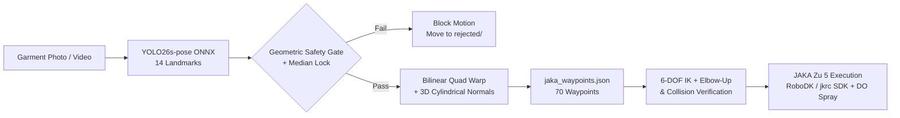
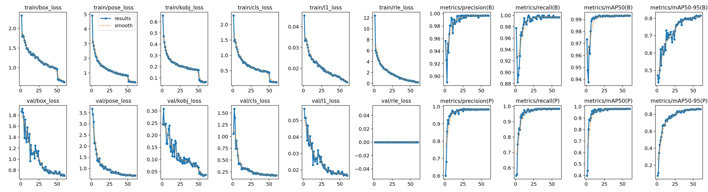
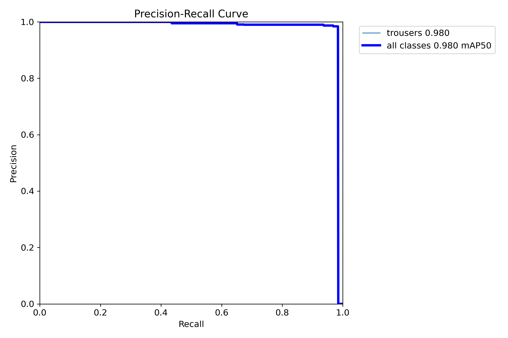
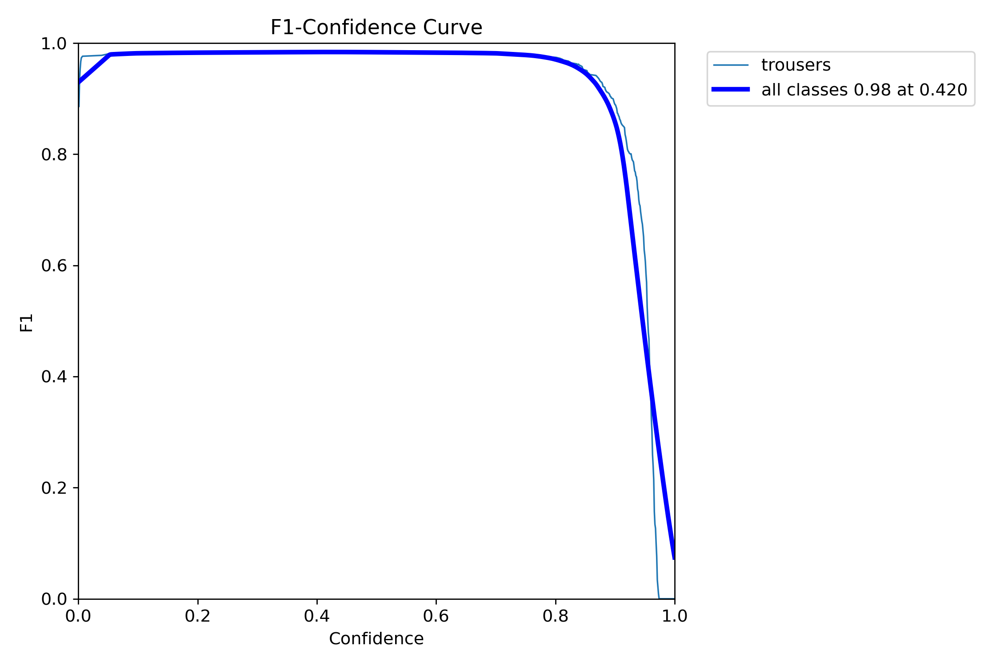
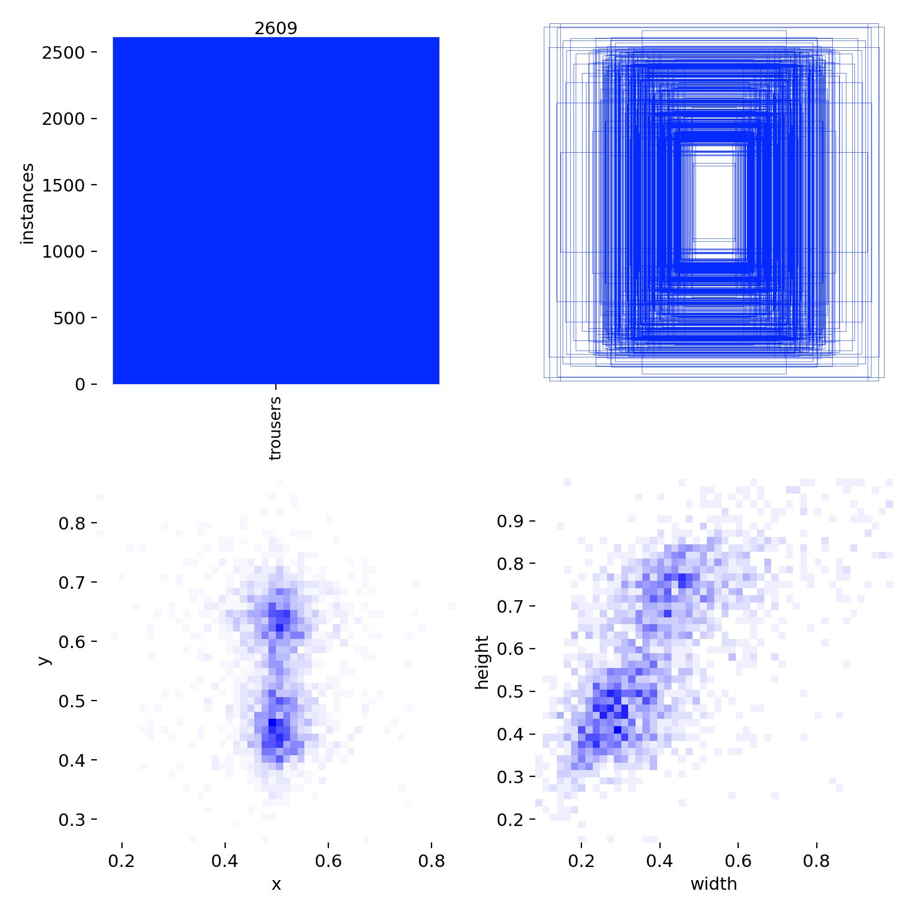

# Vision-Guided Denim Finishing Cell (JAKA Zu 5 Cobot)

End-to-end 2D-to-3D computer vision and robotic trajectory pipeline that detects 14 trouser landmarks from unseen garments and automatically generates collision-free, elbow-up 6-DOF spray paths for a **JAKA Zu 5** cobot—verified in **RoboDK** offline simulation and architected for physical `jkrc` deployment.


> **Project Status**
> - **Phase 1 (Complete):** Custom `YOLO26s-pose` model (ONNX), deterministic geometric safety gate, curved 3D surface-normal trajectory planner, and collision-free RoboDK Digital Twin.
> - **Phase 2 (Next):** Industrial RGB-D depth integration, Eye-to-Hand calibration ($T_{\text{base}}^{\text{cam}}$), physical JAKA Zu 5 dry-run via `jkrc` Python SDK, and water-spray validation on scrap denim.

---

## System Architecture



### Key Engineering Highlights
- **Custom 14-Keypoint Perception:** Filtered DeepFashion2 trousers (`category_id == 8`, low occlusion/zoom) into 3,051 clean samples and trained `YOLO26s-pose` with exact 14-point horizontal symmetry (`flip_idx`) augmentation.
- **Lock-and-Execute Safety Gate:** Enforces deterministic anatomical checks (core landmark confidence $\ge 0.55$, waist ordering, crotch-below-waist, hip/crotch alignment, and left/right knee non-swap) with multi-frame median locking before generating any robot targets.
- **Collision-Free 3D Curved Spray Paths:** Parametric bilinear warping adapts 5 horizontal raster passes (7 points/pass = 35 waypoints per thigh) to any garment scale/tilt at a fixed 200 mm standoff, using asymmetric wrap-angle clamping (`-32° to +8°` left thigh; `-8° to +32°` right thigh) to prevent inner-seam spray overlap.
- **Verified 6-DOF Cobot Kinematics:** Solves tool-frame inverse kinematics (`Paint_gun.tool`, TCP `[50.0, 0.0, 450.0]` mm) with active collision checking, `MoveL_Test()` path verification, strict elbow-up / table-clearance constraints (`Z >= 150 mm`), and synchronized Digital Output (DO pin 0) spray-valve control.

---

## Verified Performance Metrics

### Perception (`YOLO26s-pose`, 60 epochs, `imgsz=640`, Tesla T4 GPU)

| Split / Benchmark | Metric | Value |
|---|---|---|
| **Validation Split** (`n = 315`) | Box mAP@50 / mAP@50–95 | **99.3%** / **81.3%** |
| **Validation Split** (`n = 315`) | Pose mAP@50 / mAP@50–95 | **98.0%** / **86.2%** |
| **Validation Split** (`n = 315`) | Inference Speed (T4 GPU) | **11.7 ms** / image |
| **Held-Out Test Split** (`n = 135`) | Pose mAP@50 / mAP@50–95 | **97.0%** / **83.8%** |
| **Held-Out Test Split** (`n = 135`) | Median Spatial Error (@640 px) | **5.58 px** (~10 mm) |
| **Unseen Cargo Jeans Video** | Safety Gate Pass Rate | **68 / 68 frames (100%)**, 0 leg swaps |

### 6-DOF Trajectory & Kinematics (RoboDK Digital Twin — JAKA Zu 5)

| Parameter | Verified Setting / Outcome |
|---|---|
| **Tool Center Point (TCP)** | `Paint_gun.tool` — `[50.0, 0.0, 450.0]` mm |
| **Trajectory Density** | 70 waypoints (5 passes × 7 points per thigh) |
| **Verified Workspace Pose** | `roll = 90.0°`, `y_shift = +250 mm`, `z_shift = +150 mm` |
| **Motion Profile** | `MoveL` 100 mm/s spray, 180 mm/s travel, 10 mm blend radius, 80 mm retract |
| **Kinematic Verification** | 100% elbow-up, collision-free, zero reach errors or wrist flips |

---

## Training & Detection Diagnostics

| Training & Validation Curves | 
| :---: | :---: |
|  |

| Pose Precision–Recall | Pose F1–Confidence | Dataset Distribution |
| :---: | :---: | :---: |
|  |  |  |

---

## Repository Structure

```text
├── run_pipeline.py          # End-to-end orchestrator (single-shot & drop-folder watch mode)
├── vision_to_waypoints.py   # ONNX inference, geometric safety gate, and 3D waypoint planner
├── simulate_jaka_robodk.py  # RoboDK elbow-up IK solver, collision verifier, and spray simulation
├── jaka_waypoints.json      # Verified sample trajectory (run RoboDK simulation standalone)
├── notebooks/
│   └── jaka_denim_training.ipynb
├── docs/                    # Demo media and evaluation plots
├── requirements.txt
└── LICENSE
```

---

## Quickstart

### 1. Clone & Install Dependencies
```bash
git clone https://github.com/imeesam/vision-guided-denim-spray-cobot.git
cd vision-guided-denim-spray-cobot
pip install -r requirements.txt
```

### 2. Download Pretrained ONNX Weights
Download `best.onnx` from the **[v0.1.0 Release](https://github.com/imeesam/vision-guided-denim-spray-cobot/releases)** and place it in the repository root.

### 3. Run the Simulation Only (No Model Needed)
1. Open **RoboDK** with a **JAKA Zu 5** robot and **Paint gun** tool (`TCP: [50, 0, 450]` mm).
2. Run the verified sample trajectory:
```bash
python -u simulate_jaka_robodk.py
```

### 4. Run the Full Vision-to-Robot Pipeline
Keep RoboDK open, then run either mode:

- **Single image or video:**
  ```bash
  python -u run_pipeline.py --input path/to/jeans.mp4
  ```
- **Automatic watch mode (factory-style drop folder):**
  ```bash
  python -u run_pipeline.py --watch
  ```
  Drop any jeans photo or video into `incoming/`. Valid garments automatically reshape the 3D denim panels and trigger a fresh JAKA Zu 5 cycle; rejected garments are blocked and moved to `rejected/`.

---

## Current Limitations
- **Offline Simulation Only:** Kinematics and collision checks are verified in RoboDK; physical validation on the factory JAKA cobot is scheduled for Phase 2.
- **Simulated 3D Depth:** Surface normals are currently projected onto a parametric cylindrical leg model (`MANNEQUIN_Y_MM = 780 mm`) rather than measured from a live depth sensor.
- **Domain Scope:** Trained on filtered DeepFashion2 trouser images; booth lighting fine-tuning (100–200 real cell frames plus empty-mannequin negatives) is planned before production spraying.

## Phase 2 Roadmap
- [ ] Mount fixed industrial RGB-D camera and execute OpenCV Eye-to-Hand calibration ($T_{\text{base}}^{\text{cam}}$)
- [ ] Replace cylindrical projection with live RGB-D surface points and local plane-fit normals
- [ ] Port verified motion module to the physical JAKA Zu 5 via `jkrc` Python SDK (15% speed dry-air test)
- [ ] Synchronize 24V cabinet Digital Output solenoid and validate multi-size accuracy using plain water on scrap denim

---

## License & Acknowledgements
Code is released under the **MIT License**. The **DeepFashion2** dataset is governed by its own research license and is not redistributed in this repository.

Built with [Ultralytics](https://github.com/ultralytics/ultralytics), [ONNX Runtime](https://onnxruntime.ai/), [RoboDK](https://robodk.com/), and [JAKA Robotics](https://www.jakarobotics.com/).
